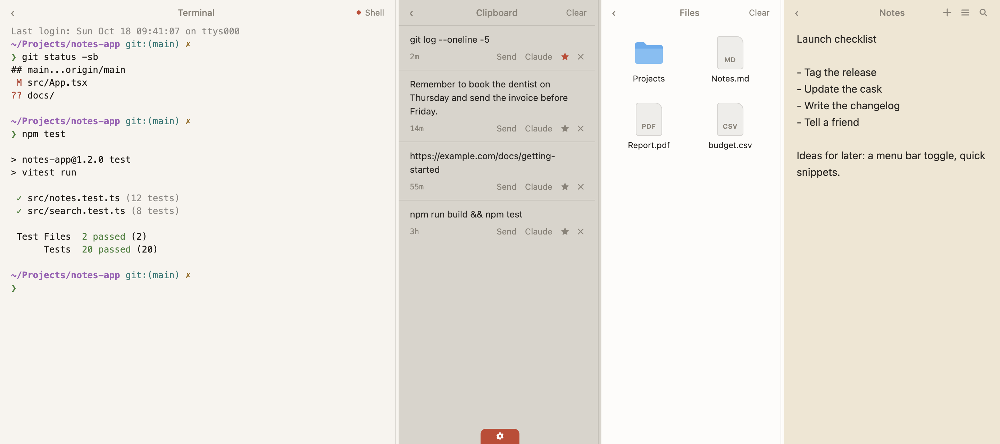
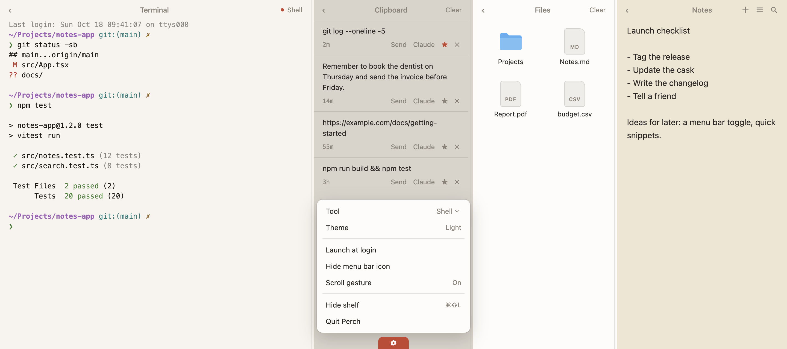

# Perch

A pull-down shelf for the tools you already run.

<picture>
  <source media="(prefers-color-scheme: dark)" srcset="docs/assets/perch-dark.png">
  
</picture>

## What it is

Perch is a macOS shelf that slides down from the top of your screen. It holds four panes side by side: a terminal, your clipboard history, a drop shelf for files, and quick notes. Pull it down, copy something, drop a file, send a note to your terminal, and put it away.

The terminal pane is a real terminal (a PTY running under your own login shell). It runs the command-line tools you have already installed, such as Claude Code or Codex. Perch embeds no model, no API client and no account.

Perch is independent software. It is not affiliated with Unclutter, Anthropic or OpenAI.

## Features

- **Terminal.** Runs Claude Code, Codex, your login shell, or a custom command. Pick the tool from the gear menu.
- **Clipboard.** History of copied text and images (the latest 50, plus favourites you star). Click an item to copy it again, send text to the terminal, or open it in Claude.
- **Files.** Drag files in to keep them close, click to open, drag them back out. Perch stores references to the files, not copies.
- **Notes.** Markdown notes with search, rename and delete. Send a note to the terminal, or open it in Claude or Claude Code.
- **Layout.** Each pane collapses to a slim rail (one pane always stays open). Drag the dividers to resize panes, which have minimum widths. Drag the bottom edge of the shelf to change its height. Your layout is remembered.
- **Themes.** Light and dark. The first launch follows the system setting; you can switch from the gear menu.
- **Shortcut and gesture.** Command-Shift-L toggles the shelf. A scroll gesture at the top edge of the screen pulls it down.

## Install

Requires an Apple Silicon Mac running macOS 13 (Ventura) or later. The cask declares `depends_on arch: :arm64` and `depends_on macos: :ventura`.

### Homebrew

```sh
brew install --cask yogeshvar/perch/perch
```

This is the same as:

```sh
brew tap yogeshvar/perch
brew install --cask perch
```

### Manual

Download `Perch-<version>-arm64.zip` from the [GitHub releases](https://github.com/yogeshvar/perch/releases), unzip it, and move `Perch.app` to `/Applications`.

### Upgrading from Ledge

Perch was previously called Ledge. On first launch, Perch moves your data from `~/Library/Application Support/Ledge` to `~/Library/Application Support/Perch` (the database is renamed from `ledge.db` to `perch.db`, and clipboard images are re-pointed at the new folder). It only does this when Ledge's folder exists and Perch has no database yet, and it never overwrites or deletes anything.

## First launch

Perch is ad-hoc signed and **not notarized**, so macOS Gatekeeper blocks the first launch of a downloaded copy. Use one of these:

- **macOS 15 and later:** try to open Perch once, then go to System Settings, Privacy & Security, and click **Open Anyway**.
- **Older macOS:** right-click `Perch.app` and choose **Open**.
- **Any version:** clear the quarantine flag.

  ```sh
  xattr -dr com.apple.quarantine /Applications/Perch.app
  ```

Homebrew does not do this for you. The cask only prints these steps.

Then, to enable the pull gesture, grant **Accessibility** access: System Settings, Privacy & Security, Accessibility, and switch Perch on. The gear menu has an **Enable...** entry for the scroll gesture that asks macOS for it. The Command-Shift-L shortcut works without Accessibility.

Because the ad-hoc signature changes with every build, macOS may ask for Accessibility again after an update.

## Using Perch

**Open the shelf**

1. Move the pointer to the very top edge of the screen (the top 28 points).
2. Scroll down with two fingers on the trackpad. A mouse wheel works too.
3. The shelf follows your fingers. Let go past about a quarter of the way open, or flick, and it opens; otherwise it closes.

The gesture is independent of the natural-scrolling setting. To close the shelf the same way, pull up at the top edge while it is open. Command-Shift-L opens and closes it at any time.

**Closing.** Escape hides the shelf, except while the terminal has focus, where Escape goes to the program running in it. Clicking outside the shelf also hides it. Escape first closes whatever is open (the gear menu, the notes list or search) or cancels a note rename; press it again to hide the shelf.

**Panes**

- Terminal: starts the first time the shelf opens. If it stops, the bar at the bottom of the pane has a **Start** button.
- Clipboard: **Clear** removes everything except favourites.
- Files: **Clear** empties the shelf (the files on disk are untouched). The magnifier button reveals a file in Finder.
- Notes: the buttons in the header create a note, open the notes list, and search. Double-click a note in the list to rename it; clear the name to go back to the first line. Deleting asks you to click twice.
- The **Claude** and **Code** buttons open `claude://` links through macOS, which needs Claude Desktop installed.

**Gear menu** (the tab at the bottom centre of the shelf):




- Tool (Claude Code, Codex, Shell, Custom; Custom adds a command field)
- Theme
- Launch at login (packaged app only)
- Hide menu bar icon / Show menu bar icon
- Scroll gesture (On, or Enable...)
- Hide shelf
- Quit Perch

**Menu bar icon.** Click it to toggle the shelf; right-click for its menu:

- Show Perch / Hide Perch
- Launch at login (packaged app only)
- Hide menu bar icon
- Scroll gesture on / Enable scroll gesture...
- Quit Perch

A development build also has Toggle Developer Tools.

**Hiding the icon.** Perch lives in the menu bar and has no permanent Dock icon (macOS may show one while the shelf is open). If you hide the menu bar icon, the shelf stays reachable with Command-Shift-L, the scroll gesture, or by opening Perch again from Applications. To bring the icon back, open the gear menu and choose **Show menu bar icon**.

## Your data and privacy

Everything lives in `~/Library/Application Support/Perch`:

| What | Where |
| --- | --- |
| Notes | stored in `perch.db`; a markdown copy of each note is also written to `notes/` (edits made outside Perch are not read back) |
| Clipboard images | `clips/` |
| Settings, clipboard text, notes, file references | `perch.db` |

Files you drop on the shelf are references to their original paths. Nothing is copied or deleted.

There are no accounts and no analytics. Perch itself makes no network requests: a search of `electron/` and `src/` finds no use of `fetch`, XHR, WebSocket, an HTTP client or an auto-updater. Two things can still reach the network, both outside Perch: whatever you run in the terminal, and links opened through the system (`claude://` links and any link the page opens, which go to your default handler). Homebrew and GitHub are involved only when you install or download.

## Troubleshooting

- **The pull gesture does nothing.** Check that Perch is switched on under Privacy & Security, Accessibility. The gear menu shows Scroll gesture On when it works. After an update you may need to grant it again. Start the gesture with the pointer in the top 28 points of the screen; it only starts when you pull in the right direction (down to open, up to close).
- **macOS says Perch cannot be opened.** See First launch above.
- **The terminal says it could not find `claude` or `codex`.** Install the tool, then press **Start**. Perch looks it up with your login shell (`$SHELL -ilc`), so the tool must be on the `PATH` that your shell rc files set up.
- **A Custom command does nothing.** It runs through your login shell; the field must not be empty.
- **The menu bar icon is gone.** Use Command-Shift-L, then the gear menu, then **Show menu bar icon**.
- **Terminal colours or keys look wrong.** Perch sets `TERM=xterm-256color`, `COLORTERM=truecolor` and `TERM_PROGRAM=Perch`. It also adds kitty's terminfo directory to `TERMINFO_DIRS` when kitty is installed, for shell setups that export `TERM=xterm-kitty`.
- **Command-Shift-L does nothing.** Another app may hold the shortcut; Perch logs a message when it cannot register it.

## Development

You need macOS on Apple Silicon, Node.js, and the Xcode command line tools (`xcode-select --install`), because the gesture helper is Swift.

```sh
npm install        # postinstall compiles native/bin/GestureHelper and rebuilds node-pty and better-sqlite3 for Electron
npm run dev        # run in development
PERCH_SHOW=1 npm run dev   # open the shelf as soon as the window is ready
npm run build      # build the app into out/
npm run package    # build the release zip into release/
```

`npm run package:dir` builds just `Perch.app`, which is faster for testing. `npm run typecheck` checks all TypeScript projects.

Tests:

```sh
npm test                # unit and UI tests (Vitest)
npm run test:coverage   # also fails below 100% statements, branches, functions and lines
npm run test:e2e        # end-to-end run
```

See [test/README.md](test/README.md) for how things are faked and what the coverage does not cover.

| Folder | Contents |
| --- | --- |
| `electron/` | Main process: window, tray, shortcut, PTY, clipboard, notes, files, database, migration |
| `src/` | The React interface (`src/shelf/` has the four panes) |
| `native/` | `GestureHelper.swift`, the scroll-gesture helper |
| `test/` | Unit, UI and end-to-end tests |
| `build/` | Icon sources and the packaging script |
| `scripts/` | `postinstall.mjs` and the ad-hoc signing hook |
| `homebrew/` | Template for the Homebrew cask |
| `docs/` | The project website |

## Releasing

See [RELEASING.md](RELEASING.md) for building the zip, publishing the GitHub release, updating the tap, and the signing and notarization notes.

## License

MIT. See [LICENSE](LICENSE).

Not affiliated with Unclutter, Anthropic or OpenAI.
